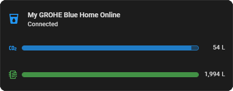

# GROHE Blue features for Home Assistant Tile card <!-- omit from toc -->

[](https://github.com/hondzik/grohe-blue-features/releases)
[](LICENSE)
[](https://github.com/hondzik)
[](https://github.com/hondzik/grohe-blue-features/commits/main)

Home Assistant Lovelace **Tile card features** that show the remaining **CO2** and **filter** capacity of a GROHE Blue water dispenser as a progress bar underneath a Tile card, the same way built-in features like "Cover open/close" attach to a Tile card.

The features are built for the [Grohe Smarthome](https://github.com/Flo-Schilli/ha-grohe_smarthome) integration (`grohe_smarthome`).



## Table of contents <!-- omit from toc -->

- [Features](#features)
- [Installation](#installation)
- [Usage](#usage)
- [Configuration options](#configuration-options)
- [How the sensors are found](#how-the-sensors-are-found)
- [Using the visual editor](#using-the-visual-editor)
- [Troubleshooting](#troubleshooting)
- [Translations](#translations)

## Features

| Feature | Type | Default color | Default icon |
| ------- | ---- | ------------- | ------------ |
| Grohe Blue CO2 level | `custom:grohe-blue-co2-feature` | blue | `mdi:molecule-co2` |
| Grohe Blue filter level | `custom:grohe-blue-filter-feature` | green | `mdi:air-filter` |
| Grohe Blue CO2 + filter level | `custom:grohe-blue-combined-feature` | blue / green | as above |

Both features share the same options: value in **percent or liters**, progress bar **color**, value **position** (left or right of the bar) and an optional **icon**.


### Combined feature

`grohe-blue-combined-feature` shows both bars side by side in a single row: `[icon/value] CO2 bar  gap  filter bar [icon/value]`. The outer edge cells hold either the **icon** or the **value**, and the order of the bars can be swapped.


| Option | Type | Default | Description |
| ------ | ---- | ------- | ----------- |
| `unit` | `percent` \| `liter` | `percent` | Unit of the values (used with `edge_content: value`). Bars always follow the percentage. |
| `edge_content` | `icon` \| `value` | `icon` | What is shown at the outer edge of each bar. |
| `order` | `co2_filter` \| `filter_co2` | `co2_filter` | Which bar comes first (left). |
| `co2_color` / `filter_color` | string | `blue` / `green` | Bar colors (palette name or CSS color). |
| `co2_icon` / `filter_icon` | string | feature default | Custom icons. |
| `co2_entity` / `co2_liters_entity` / `filter_entity` / `filter_liters_entity` | string | auto | Sensor overrides. |

```yaml
features:
  - type: custom:grohe-blue-combined-feature
    edge_content: value
    order: filter_co2
    unit: liter
```

## Installation

Install through [HACS](https://hacs.xyz/) by adding this repository as a custom repository (category: **Dashboard** / plugin), or use the button below.

[](https://my.home-assistant.io/redirect/hacs_repository/?repository=grohe-blue-features&owner=hondzik&category=Plugin)

HACS registers the Lovelace resource automatically. After installing, refresh your browser (Ctrl+F5).

## Usage

Add a Tile card for any entity of your GROHE Blue device and add the feature from the feature picker (**Grohe Blue CO2 level** / **Grohe Blue filter level**). The features are only offered for entities of the `grohe_smarthome` integration.

```yaml
type: tile
entity: sensor.kitchen_my_grohe_blue_home_remaining_co2
features_position: bottom
vertical: false
features:
  - type: custom:grohe-blue-co2-feature
  - type: custom:grohe-blue-filter-feature
    unit: liter
    color: teal
    value_position: left
```

## Configuration options

All options can be set in YAML or in the visual editor.

| Option | Type | Default | Description |
| ------ | ---- | ------- | ----------- |
| `unit` | `percent` \| `liter` | `percent` | Unit of the value next to the bar. The bar itself always follows the percentage. |
| `color` | string | `blue` (CO2), `green` (filter) | Bar color. A Home Assistant palette name (`red`, `deep-orange`, `teal`, …) or any CSS color. |
| `value_position` | `left` \| `right` | `right` | Position of the value relative to the bar. |
| `show_icon` | boolean | `true` | Show an icon in front of the bar. |
| `icon` | string | feature default | Custom icon, e.g. `mdi:gas-cylinder`. Empty means the default icon. |
| `entity` | string | auto | Percentage sensor override. |
| `liters_entity` | string | auto | Liters sensor override. |

## How the sensors are found

You don't have to configure any entity. The feature looks at the device of the Tile card's entity and picks:

| Feature | Percentage sensor (bar, `%` value) | Liters sensor (`liter` value) |
| ------- | ---------------------------------- | ----------------------------- |
| CO2 | `*_remaining_co2` | `*_remaining_co2_total` |
| Filter | `*_remaining_filter` (falls back to `*_remaining_filter_app`) | `*_remaining_filter_total` |

If an entity was renamed, the sensors are still matched by the words `co2` / `filter` in the entity id or name together with the unit (`%` or `L`). In `liter` mode the bar still uses the percentage sensor; when no liters sensor is available the value falls back to percent.

Use `entity` / `liters_entity` to override the automatic choice.

## Using the visual editor

Use the pencil icon next to the feature in the Tile card editor. The dialog shows which sensors are in use (**auto** / **manual** chip) and lets you change the unit, color, value position and icon.


## Troubleshooting

- **The feature is not offered in the picker** — the Tile card's entity must belong to the `grohe_smarthome` integration.
- **The bar is empty and the value shows "–"** — the percentage sensor is unavailable. Check the sensor in Developer tools → States.
- **The value is shown in percent although `unit: liter` is set** — no liters sensor was found; set `liters_entity` manually.
- **Bar spacing** — the feature is a single row; no `grid_options.rows` change is needed.

## Translations

The visual editor is localized into Czech, German, English, Spanish, French, Hungarian, Italian, Dutch, Norwegian, Polish, Portuguese, Slovak, Swedish and Ukrainian (falls back to English). Issues and PRs with translation fixes are welcome.
